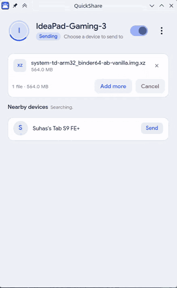

<p align="center">
  
</p>

<h1 align="center">QuickShareLinux</h1>

<p align="center">
  <strong>Yet another Quick Share app for Linux.</strong>
</p>

<p align="center">
  <a href="LICENSE"></a>
  
</p>

Based on the works of [google/nearby](https://github.com/google/nearby) and the patches of [kidfromjupiter/nearby](https://github.com/kidfromjupiter/nearby).

I decided to make this a separate repo instead of a fork, mainly because I didn't like the messy, unorganized codebase of Google.

Also I hate Bazel.

Most of the original code is still here, reorganized and rewritten so it's actually organized. Also some quality-of-life improvements of my own, a nice GUI, and packaging for Flatpak, Arch, and AppImage.

## Demos

Played at the original speed. These recordings are not sped up.

<table>
  <tr>
    <td align="center"><strong>Send</strong></td>
    <td align="center"><strong>Receive</strong></td>
  </tr>
  <tr>
    <td></td>
    <td></td>
  </tr>
</table>

## Build

You need CMake 3.24 or newer, Ninja, a C++20 compiler, and Qt 6.10 (Core, Gui, Widgets, Quick, Qml, DBus), plus Abseil, Protobuf, OpenSSL 3, sdbus-c++, nlohmann-json, libcurl, libsystemd, and BlueZ.

```bash
cmake -S . -B build -G Ninja -DCMAKE_BUILD_TYPE=Release
cmake --build build
./build/ui/quickshare
```

Bluetooth discovery needs BlueZ. Wi-Fi Direct and hotspot connections need NetworkManager, and mDNS discovery on the local network needs Avahi.

Flatpak build steps are in [`packaging/flatpak/README.md`](packaging/flatpak/README.md). The Arch package is [`packaging/arch/PKGBUILD`](packaging/arch/PKGBUILD).

## License

GPL-3. See [LICENSE](LICENSE).

The Nearby code is still Apache-2.0. Those copyright headers stay. The Apache text is in [LICENSE.Apache-2.0](LICENSE.Apache-2.0). Details are in [NOTICE](NOTICE).
